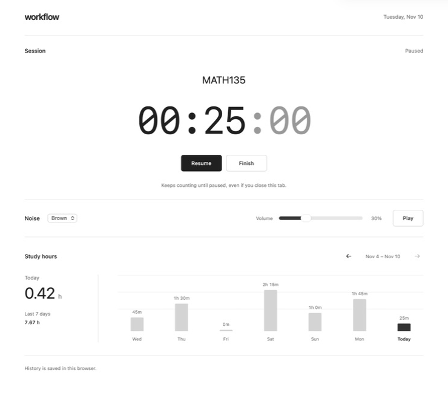

# Workflow

A minimal study timer with background noise and daily study hours.

**[Open Workflow →](https://workflow.yuvijain.com)** · [Report a bug](https://github.com/imyuvijain/workflow/issues) · [Suggest a feature](https://github.com/imyuvijain/workflow/issues)

No sign-up, ads, or subscriptions. Open it in your browser and start a session.

[](https://workflow.yuvijain.com)

*Screenshot shows an example session with demo study data.*

## What it does

- **Name your session.** Type a course, project, or task, such as `MATH135`. The title stays with the timer across pauses and reloads.
- **Track your time.** Start, pause, resume, and finish sessions. Daily totals are split at local midnight, including overnight sessions.
- **See your study hours.** Check today's total and browse earlier days in the seven-day chart.
- **Choose your background noise.** Switch between brown, pink, and white noise, with one volume control. Brown noise includes Classic, Deep, Soft, and Rolling templates, plus optional warmth and movement controls. Sound is generated on your device, with no audio downloads or repeating tracks.
- **Keep it simple.** A responsive monochrome interface with system fonts and keyboard-accessible controls. Light and dark mode follow your system settings automatically.

## Start a session

1. Open **[workflow.yuvijain.com](https://workflow.yuvijain.com)**.
2. Enter a session title if you want one, then click **Start**.
3. Pick a noise type and press **Play**. Audio and the timer work independently.
4. Use **Pause** for a break. **Finish** clears the session title and timer; your daily study hours remain saved.

**A running timer keeps counting until you pause or finish it, even if you close the tab.** Pause it when you stop working.

### Noise types

| Sound | Character |
| --- | --- |
| Brown | Deep, low rumble |
| Pink | Softer hiss with more low frequencies than white noise |
| White | Bright, steady hiss |

You can change sounds during playback. Transitions fade between types, and your sound and volume preferences are remembered. Audio starts only when you press Play.

For brown noise, choose a **Template**: Classic preserves the original sound, Deep reduces the higher frequencies, Soft gently rounds them off, and Rolling adds a slow volume swell. Open **Customize** to adjust **Warmth** and **Movement** yourself. These settings are remembered and apply only to brown noise; the main volume stays independent.

## Your data

Session titles, timer state, study totals, and sound preferences are stored in your browser's local storage. Workflow has no accounts, analytics, or database.

- Data does **not** sync between devices, browsers, or website addresses.
- Clearing the site's browser data removes your study history.
- Private browsing may discard history when the browser session ends.

## Run it locally

No dependency installation is needed. With Git and Python 3:

```sh
git clone https://github.com/imyuvijain/workflow.git
cd workflow
python3 -m http.server 4173 --bind 127.0.0.1
```

Open **http://127.0.0.1:4173** in a current browser. Use localhost or HTTPS so the audio worklet can run.

For development checks, use Node.js 20 or newer:

```sh
npm test
npm run build
```

Tests cover timer persistence, session titles, pauses, overnight sessions, daylight saving changes, the frequency balance and transitions of all three noise types, and brown-noise templates and customization. The optional build exports the public assets to `dist/`.

## Host your own copy

Workflow is a static website: HTML, CSS, and JavaScript, with no backend or runtime dependencies.

For GitHub Pages:

1. Fork the repository.
2. Delete `CNAME`, or replace its contents with your own custom domain.
3. In your fork, select **Settings → Pages → Deploy from a branch → main → / (root)**.
4. Open the URL shown by GitHub after deployment.

Relative asset paths support repository subpaths. You can also serve the exported `dist/` folder with any static host. The export retains `CNAME` when that file exists.

## Contributing

Issues and pull requests are welcome. For bugs, include your browser, what you did, and what you expected. For feature ideas, explain the study workflow they would help with.

The interface intentionally stays small: a timer, background noise, and study history.
